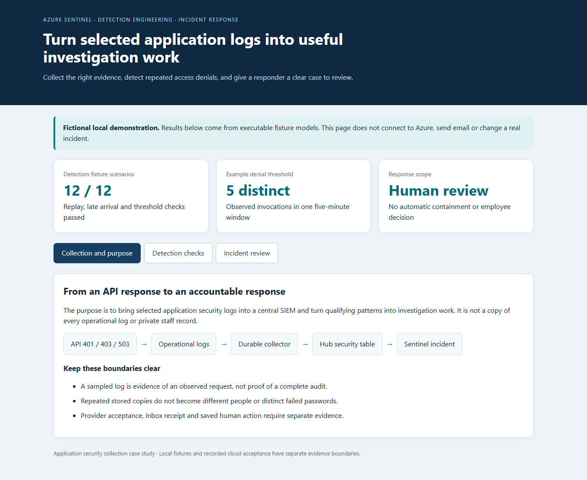
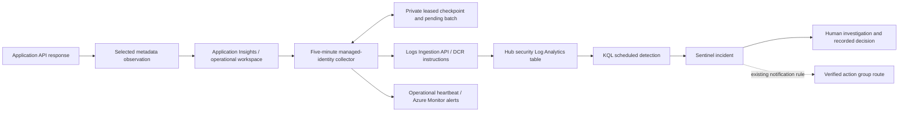
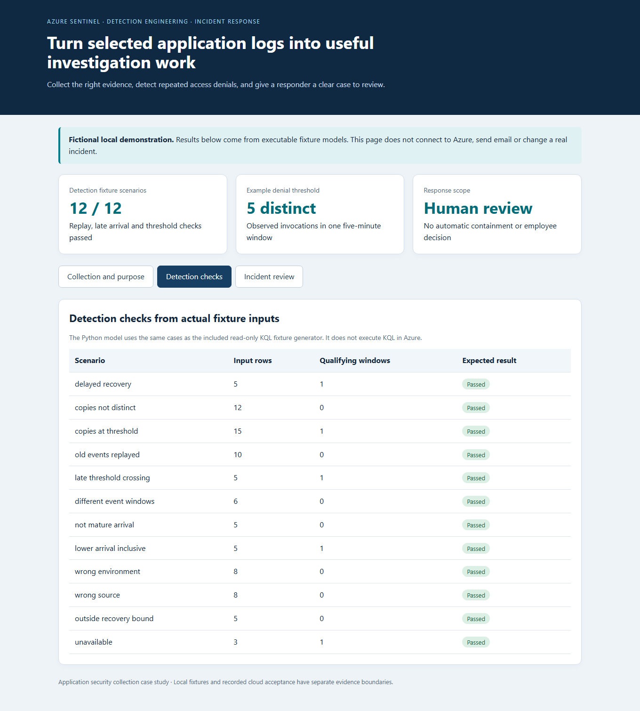
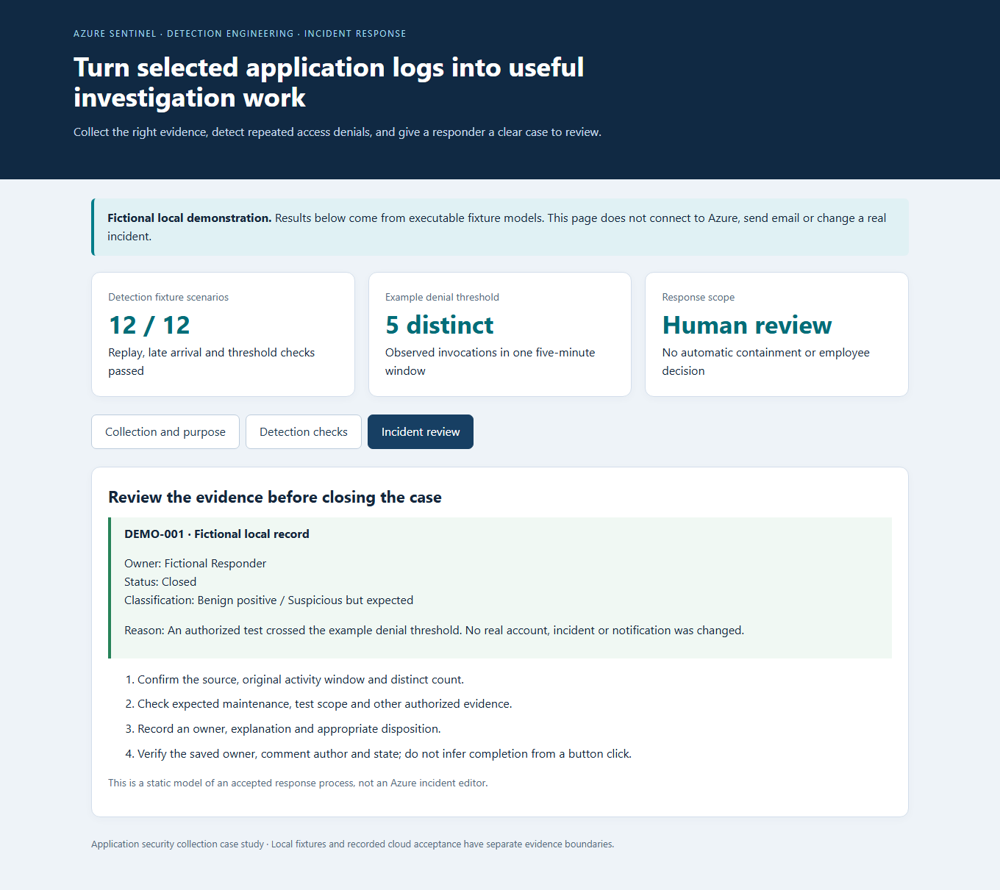

# Application Security Monitoring with Microsoft Sentinel

**Bring selected application logs into a central SIEM, detect useful patterns, and give a responder clear investigation work.**

[Purpose](#the-purpose) · [Business problem](#the-business-problem) · [What was built](#what-was-built) · [Proof](#proof-it-works) · [Step by step](#step-by-step) · [Run it](#run-it-locally)



## The Purpose

The purpose is to **ingest selected application security logs into Microsoft Sentinel**, turn qualifying patterns into alerts and incidents, and support an accountable human response. SIEM means Security Information and Event Management: a place to bring security evidence together and investigate it.

For this implementation, selected API responses—`401` (authentication needed or rejected), `403` (access denied) and `503` (service unavailable)—become a small, consistent security record. Ordinary operational logs stay in the application environment; the collector forwards the selected metadata to the central hub security workspace. It does not copy every application log, request body or employee record.

## The Business Problem

A healthcare workforce application can still load while staff receive repeated access errors, a role is misconfigured or a dependency becomes unavailable. Those symptoms can look alike in a dashboard even though an expired session, an intentional test, an application fault and unauthorized activity require different responses.

The operator needs to know what was actually observed, whether that evidence reached the security workspace, why a rule opened a case and who reviewed it. Missing logs, delayed collection and duplicate records can make that answer unreliable. A notification marked accepted also does not establish that the person received it or acted.

The business need was a traceable path from **application behavior to useful investigation work**, with controlled access, limited private data, visible collection failures and clear response ownership.

## The Solution

I implemented a small application-security log route using Application Insights, a durable managed-identity collector, a hub Log Analytics table, KQL detections and Microsoft Sentinel incidents. Azure Monitor separately watches whether the collector itself is working.

**Business outcome:** Operators can follow a selected application event through collection and detection, review its meaning, and verify saved response actions. Initial production collection and a bounded incident-response exercise were accepted; longer-term noise, cost and coverage reviews remain ongoing.

This project draws on an implemented Azure workforce platform. The public source uses fictional resource bindings and selected original tests; organization details, live targets, credentials and private records are excluded. The screenshots below show a **working fictional local model**, not an Azure portal capture or a new production incident. [Validation scope](docs/VALIDATION.md) separates those evidence types.

## Tools Used and What They Do

| Tool or service | Purpose in this project |
| --- | --- |
| Azure Functions, Node.js and TypeScript | Observe selected completed API responses and run the five-minute collector. |
| Application Insights and Log Analytics | Store application telemetry and the selected central security records in separate workspace contexts. |
| Managed identity and Azure RBAC | Authenticate the collector without an app password and limit source-reader/DCR-publisher grants. |
| Blob Storage leases and ETags | Coordinate one saved checkpoint and pending batch; reject stale writes. |
| DCR and Logs Ingestion API | Define the custom record shape/destination and accept authorized batches. A DCR is configuration, not a queue. |
| KQL and Microsoft Sentinel | Count distinct observations, handle delayed evidence and create reviewable security cases. |
| Azure Monitor and action groups | Watch collector health and use a separately verified notification route. |
| Terraform and ARM templates | Make definitions and permission scopes reviewable; public examples start disabled. |
| Python, Node test runner and Playwright | Exercise fictional scenarios, original implementation tests and local evidence-page behavior. |

## Step by Step

1. **Choose useful application evidence.** Record selected denied or unavailable API responses with their original time and stable identifier. Exclude tokens, request bodies and employee contents from this projection.

2. **Deliver it to the security workspace.** Read mature source records using managed identity and save pending work before sending it. Keep the saved position and any unresolved batch when a request fails.

3. **Detect a meaningful pattern.** Count distinct observations in the original five-minute activity window, while using first arrival to handle late evidence. Replayed copies must not create extra distinct events.

4. **Open and review the case.** Check the source, count, time window and expected activity before choosing a disposition. Record the owner and explanation, then verify the saved result.

5. **Check notification and collector health separately.** Distinguish a generated incident, a provider-accepted message, actual receipt and human action. Use heartbeat, checkpoint age and pending state to detect problems in the collection path.

6. **Observe before tuning.** Review normal volume, duplicates, late data, analyst workload and posted costs over time. Change thresholds or scale only when evidence justifies the tradeoff.

## Architecture



No new always-running VM or automatic account containment is required. The collector shares the API host, so API downtime also stops collection. [Collection and identity boundaries](docs/ARCHITECTURE.md)

## What Was Built

| Component | What it does | Code or guide |
| --- | --- | --- |
| Metadata-only API observer | Select handled numeric 401/403/503 responses without inspecting sensitive request contents. | [Observer](reference/securityHttpEvents.ts) |
| Stable event projection | Validate selected records and derive consistent identifiers. | [Projection](reference/securityHttpExport.ts) |
| Durable collector | Save a checkpoint/outbox, coordinate ownership, bound recovery and retry unresolved work. | [Collector](reference/securityDurableDelivery.ts) |
| Azure delivery adapter | Use managed identity, bounded requests, Blob lease renewal and conditional writes. | [Adapter](reference/securityDeliveryAzure.ts) |
| Detection and health queries | Handle delayed arrival, duplicates, quiet sources and missing collector progress. | [KQL](queries) · [original renderer](scripts/security_continuous_detections.py) |
| Infrastructure examples | Define disabled Sentinel/Monitor rules and optional resource-scoped reader/publisher grants. | [Terraform](infra/README.md) · [ARM renderer](scripts/security_continuous_delivery.py) |
| Analyst response procedure | Review evidence, assign responsibility, document a decision and verify saved state. | [Incident response](docs/INCIDENT-RESPONSE.md) |
| Fictional local workbench | Run twelve detection fixtures and display a clearly labelled response example. | [Model](lab/detection.py) · [demo](lab/demo.py) |

The legacy nonproduction exporter is retained only because the durable collector reuses its projection code. It is not the production delivery method. [Source map](docs/SOURCE-MAP.md)

## Proof It Works

### 1. Selected original source tests run offline

```bash
npm ci --ignore-scripts
npm test
```

The tests exercise observation privacy, projection validation, saved-batch replay, bounded retry, dense windows, stale ownership and Azure-adapter seams. They do not sign in to Azure or send messages. Current results are in the [dated validation record](docs/validation-results.json).

### 2. Duplicate and delayed events have different outcomes

```bash
python -B -m unittest discover -s tests -v
python -B -m unittest discover -s scripts -p 'test_*.py' -v
python -B -m lab.demo
```

The offline model checks the same twelve scenarios used by the included KQL fixture generator. It shows why four observations copied three times stay below five, while a late fifth distinct event can cross the original window's threshold. **The Python model is not a Kusto interpreter; public local results do not claim a fresh Azure KQL execution.**



### 3. Response ownership is part of acceptance

The actual platform exercise verified a scoped Responder identity, a saved owner, the human-authored rehearsal comment and expected-test closure. It used an existing labelled test case; it did not claim a new automatic incident or a new incident-email cycle. The public workbench displays a fictional explanation of that process. [Response evidence and limits](docs/INCIDENT-RESPONSE.md)



### 4. Production observation is recorded without overstating it

The November 14 eight-hour checkpoint recorded **97 timer reports: 93 progress and four backoff**. The four backoff reports represented two processing failures and their waiting ticks; both recovered. The latest report had pending=0 and checkpoint age=301 seconds.

One distinct commissioning event had two stored copies, totaling 800 billable bytes. That is initial evidence, not proof of complete audit coverage, a long-term service level or representative natural traffic. Posted workspace charges lagged the rollout; a tiny row sample is not a monthly forecast. [Detailed acceptance boundaries](docs/VALIDATION.md)

## Run It Locally

Requires Node.js 22+ and Python 3.12+. From the repository root:

```bash
npm ci --ignore-scripts
npm test
python -B -m unittest discover -s tests -v
python -B -m unittest discover -s scripts -p 'test_*.py' -v
python -B -m lab.demo
python -m http.server 8017 --bind 127.0.0.1 --directory out
```

Open [the local workbench](http://127.0.0.1:8017), review all three sections, then stop the server with Ctrl+C. On Windows, use `python.exe` or `py -3.12` if that is your installed launcher; the commands otherwise stay the same. No Azure login, real employee record or paid provider operation is needed. [Full commands](docs/COMMANDS.md)

## Strengths, Weaknesses and Tradeoffs

- **Strengths:** Small consistent evidence, keyless authentication, durable pending work, visible collection health, replay-aware counting and verified human action.
- **Weaknesses:** Source logging is sampled/best effort, the shared API host is a shared failure boundary, the projection lacks user/IP attribution, and bounded recovery can stop visibly.
- **Tradeoffs:** More context helps investigation but increases privacy exposure; lower thresholds increase analyst work; longer retention and replayed copies can cost more.

Measure normal volume, lag, duplicates, query limits and responder workload before adding a dedicated worker or more partitions. [Scaling and cost decisions](docs/SCALING.md)

## Troubleshooting Lessons

Expected role-assignment changes can open a case without proving compromise. A generic `DELIVERY_TRANSPORT` label does not establish a network root cause. An HTTP 403 can come from an incorrect reader operation, and provider acceptance can precede missing inbox receipt. Each required following the actual evidence path rather than widening permissions or replaying a business action. [Lessons and fixes](docs/LESSONS-LEARNED.md)

## Project Guides

| Guide | What it explains |
| --- | --- |
| [Architecture and collection design](docs/ARCHITECTURE.md) | Sources, storage, identity, privacy and failure boundaries |
| [Implementation walkthrough](docs/WALKTHROUGH.md) | How the code and queries work together |
| [Incident response](docs/INCIDENT-RESPONSE.md) | Triage, escalation, disposition and saved human evidence |
| [Operations and troubleshooting](docs/OPERATIONS.md) | Heartbeat, retry, delayed data, recovery and pause |
| [Commands](docs/COMMANDS.md) | Local tests, query generation and separate cloud prerequisites |
| [Validation](docs/VALIDATION.md) | Current local checks versus recorded hosted acceptance |
| [Terraform integration](infra/README.md) | Disabled definitions and optional scoped grants |
| [Source map](docs/SOURCE-MAP.md) | Extracted code versus new public examples |
| [Scaling and costs](docs/SCALING.md) | Measured bottlenecks, analyst capacity and billing boundaries |
| [References](docs/REFERENCES.md) | Official documentation used for the design |

## Repository Map

```text
reference/           Selected implementation modules and original tests
functions/           Selected observer/timer registration modules
examples/            Relevant disabled nonproduction settings only
scripts/             ARM/KQL renderers, original plan checks and publication review
queries/             Reviewed detection and collector-health KQL
infra/               Terraform integration, example inputs and mock plan tests
lab/                 Fictional offline detection model and demo generator
demo/                Local evidence-page template
tests/               Additional model boundary cases
docs/                Architecture, operations, response, evidence and screenshots
.github/workflows/   Manual-only local contracts; no cloud deployment permission
```

## Security and Cleanup

The local demo writes only `out/`; it does not enable services, send alerts or edit Sentinel. Infrastructure validation is separate from deployment, and applying cloud examples can incur charges. Do not apply the Terraform and ARM alternatives to the same objects without deciding ownership and imports. Keep real state files, credentials and incident contents out of this repository. [Security and publication boundary](SECURITY.md)
