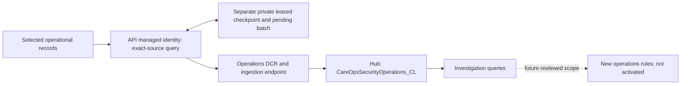

# Operations and recovery evidence in the security workspace

## The business problem

A healthy web page does not answer whether recovery coverage is current, an email bounced, or recovery storage rejected a caller. Operators need selected evidence in the security workspace without exposing backup contents, recipients or employee records, and without repeating the business operation to investigate it.

## What changed in the actual platform

A separate five-minute collector now selects existing operational records and sends eleven approved metadata fields into `CareOpsSecurityOperations_CL`. Original records stay in the operational workspace. This route has its own private checkpoint, pending batch, DCR and publisher grant; the existing HTTP stream remains separate.

| Source table | Selected evidence | What it does not prove |
| --- | --- | --- |
| `ContainerAppConsoleLogs` | Structured receipts from the exact configured payroll recovery environment, job and container. | A current-coverage receipt is not a completed restore rehearsal. |
| `ACSEmailStatusUpdateOperational` | Terminal delivery outcomes from the configured communication resource. | Delivered does not prove inbox visibility or human reading. |
| `StorageBlobLogs` | Access denial or successful account-key use on the configured recovery storage resource. | A denied request or key use is not automatically compromise. |

The fields are original event time, stable event ID, schema, environment, source resource, source kind, event kind, outcome, reason, operation and authentication category. Raw console messages, message identifiers, recipients, URLs, IPs, employee records, backup contents and credentials are excluded. Stable hashes support correlation; they do not establish actor identity or full anonymization.



## How to investigate

Run this read-only example only in the appropriate Sentinel-linked workspace with existing authorized access. It is not a new scheduled rule or a command that creates data.

```kusto
CareOpsSecurityOperations_CL
| where Environment == "production" and TimeGenerated > ago(1d)
| summarize arg_max(TimeGenerated, *) by EventId
| summarize DistinctEvents=count() by SourceKind, EventKind, Outcome
```

ClickOps: open the hub Log Analytics workspace, inspect the operations table and its retention, then inspect the DCR destination and scoped publisher. In Logs, compare a bounded source cohort with destination IDs and collector progress. An empty interval means no selected records were returned; confirm source coverage separately.

## Recorded acceptance: November 14, 2026 UTC

The fictional nonproduction cohort produced one stored row and one distinct event. Later ticks and a host restart resumed the saved cursor without another copy. Exact settings and the API pause were restored, the two temporary host-storage endpoints removed, and the original DNS/network state verified.

The actual production healthy recovery cohort matched all eleven selected fields. It produced two stored rows but one distinct ID, totaling 718 billed row bytes. The next ordinary tick advanced without another stored copy, with zero pending work and zero attempts. The existing HTTP collector also resumed progress after a temporary generic transport backoff. These are dated observations, not a new test run performed by this public repository.

Collection is live. New operations-specific detectors and notifications are not activated. Existing HTTP detections and notification routes retain their separate scope. No forced backup, restore, email, provider check or failure was used to manufacture the production cohort.

## Lessons, limits and scaling

- Use source arrival time for collection windows while keeping original event time in the evidence. A delayed source receipt can otherwise be missed.
- Save the batch before sending, advance after confirmed acceptance and deduplicate stable IDs during investigation. Lost responses or repeated source evidence can create stored copies; the exact cause of this cohort's duplicate was not traced.
- Private host storage still needs a reachable network path. Identical source/package publication passed after a separately approved temporary Blob/Queue path was restored; the paths were removed afterward.
- Read back exact timestamps. Zero fractional seconds were normalized in settings and failed a strict parser; a fixed nonzero-millisecond bootstrap survived readback with the expected cohort unchanged. Never invent a new bootstrap to skip an established backlog.
- Positive healthy-cohort delivery does not prove a hosted negative authorization probe. The exact row condition was inspected; an unapproved-source query was not separately exercised through the collector identity.
- Backstage PostgreSQL helper output lacks confirmed centralized structured receipts. Key-rotation collection and natural failure/noise/cost observations remain separate work.

**Strengths:** Explicit source selection, small fields, managed identity and independent durable state. **Weaknesses:** Missing source telemetry remains missing, the shared API host is a shared availability boundary, and there is no new operations incident rule. **Tradeoffs:** A second stream adds query, Function and ingestion work while avoiding a wholesale workspace copy.

Measure distinct events versus stored copies, billed bytes, source delay, cursor lag and query duration before scaling. Current batches are bounded to 500 rows and 500,000 serialized bytes, with six steps and a 35-second soft work limit per tick. Changes must preserve recovery bounds, ownership, row permissions, DCR limits, cost control and useful analyst workload.

## Public implementation boundary

The repository's selected HTTP implementation snapshot and its runnable local fixtures remain unchanged. This page describes the later accepted operations extension; it is not a claim that the complete operations Function host, production bindings or its deployment resources are included here. Local screenshots and test counts retain their original fictional scope.
